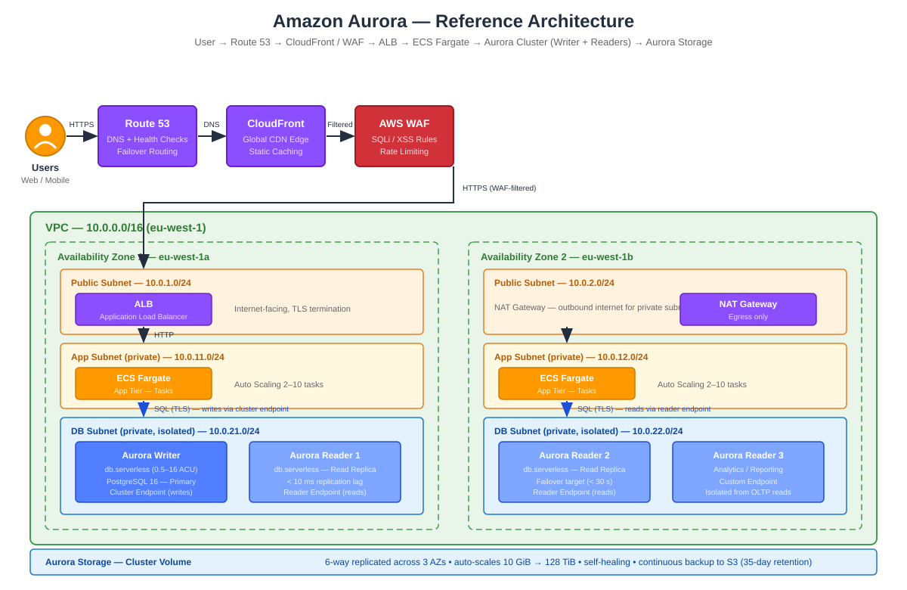

# Amazon Aurora — Done Right


> **TL;DR:** Aurora is AWS's cloud-native relational database — MySQL/PostgreSQL-compatible, up to **5× faster than MySQL** and **3× faster than PostgreSQL**, with storage that auto-scales to 128 TB, replicas in under 10 ms, and serverless scaling that follows your traffic. This guide shows you how to run it properly: right-sized instances, Aurora Serverless v2, Global Database, cloning, backtrack, and the Data API.

---

## 📐 Architecture



**Traffic flow:** `User → Route 53 → CloudFront / WAF → Application Load Balancer → App tier (ECS on Fargate) → Aurora cluster (writer + readers) → Aurora storage (6-way replicated across 3 AZs)`

---

## 🌍 In plain words — what is this, really?

Picture a very busy library whose most popular book is never stored as a single copy: the library keeps six copies spread across three buildings, so if one building floods, readers barely notice and no page is ever lost. Aurora is that idea applied to a database — it speaks the same language as MySQL or PostgreSQL, so your app barely changes, but underneath, your data is copied six ways across three Availability Zones on storage that grows automatically as you add more "books". One main librarian handles writing new entries (the writer instance), while up to fifteen helpers handle reading requests at once (read replicas), each only milliseconds behind. If the main librarian goes home sick, a helper is promoted in under thirty seconds and the front-desk sign — the cluster endpoint — keeps pointing visitors to the right person, so your app does not need a new address. Aurora Serverless v2 adds flexible staffing: more librarians appear automatically on busy days and the team shrinks when the library is quiet, and you pay for the capacity actually used. It costs more than a plain single-copy library, which is why this guide also covers when ordinary RDS is the smarter choice.

## 🧠 Why Aurora (and when not to use it)

| Feature | Aurora | RDS MySQL / PostgreSQL | When Aurora wins |
|---|---|---|---|
| Storage scaling | Auto-scales to 128 TB, no pre-provisioning | Fixed, manual scaling | Unpredictable growth |
| Read replicas | Up to 15, < 10 ms lag | Up to 5, higher lag | Read-heavy workloads |
| Failover | < 30 s (typically) | 60–120 s | Strict availability SLAs |
| Cloning | Copy-on-write, seconds, near-zero cost | Snapshot restore, slow | Dev/test environments |
| Serverless | Aurora Serverless v2 (0.5–128 ACU) | None | Spiky / intermittent traffic |
| Cost | Higher per-instance, lower at scale | Lower entry price | High-throughput workloads |

**Skip Aurora when:** your workload is tiny and steady (plain RDS is cheaper), you need a database engine Aurora doesn't support, or you need features Aurora drops (e.g. some PostgreSQL extensions).

---

## ⚙️ Core Concepts

### 1. Cluster, not instance
An Aurora **cluster** = 1 writer + up to 15 readers + a shared **cluster volume**. Storage is decoupled from compute: the volume replicates your data **6 ways across 3 Availability Zones** and repairs itself automatically. Adding a reader never means copying data.

### 2. Aurora Serverless v2
Scales in fine-grained **Aurora Capacity Units (ACU)** — 1 ACU ≈ 2 GiB RAM + CPU — from 0.5 to 128 ACU per instance, in seconds, with no connection drops. Set a min/max and let it follow traffic. Mix serverless readers with a provisioned writer if you like.

### 3. Endpoints — use the right one
| Endpoint | Use for |
|---|---|
| **Cluster endpoint** | All writes — always points at the current writer |
| **Reader endpoint** | Load-balanced reads across all readers |
| **Custom endpoint** | A subset of readers (e.g. analytics only) |
| **Instance endpoint** | Direct access to one specific instance |

> ⚠️ Never hard-code the writer's DNS name. After a failover the writer changes — the **cluster endpoint** follows it automatically.

### 4. Global Database
One primary region + up to 5 secondary regions, with **< 1 second** cross-region replication lag. Secondaries are read-only until you promote one — a planned promotion takes under a minute, an unplanned failover typically under a minute too. Use it for disaster recovery and for low-latency reads worldwide.

### 5. Cloning & Backtrack
- **Cloning:** copy-on-write clone of a cluster in minutes, using almost no extra storage until data diverges. Perfect for dev/test copies of production data.
- **Backtrack:** rewind a cluster to any point in the last 72 hours — without restoring a snapshot. Ideal for "oops, that migration dropped the wrong table".

### 6. RDS Data API
HTTPS-based SQL access for Aurora Serverless — no persistent connection, no driver, no connection pool. Perfect for Lambda functions: each invocation just calls the API.

---

## 🚀 Quick Start

### Create a Serverless v2 cluster (AWS CLI)

```bash
aws rds create-db-cluster \
  --db-cluster-identifier shop-db \
  --engine aurora-postgresql \
  --engine-version 16.4 \
  --master-username app_admin \
  --manage-master-user-password \
  --serverless-v2-scaling-configuration MinCapacity=0.5,MaxCapacity=16 \
  --vpc-security-group-ids sg-0123456789abcdef0 \
  --db-subnet-group-name shop-db-subnets

aws rds create-db-instance \
  --db-instance-identifier shop-db-writer \
  --db-cluster-identifier shop-db \
  --db-instance-class db.serverless \
  --engine aurora-postgresql
```

### Connect from Python (see `aurora.py`)

```python
from aurora import AuroraClient

client = AuroraClient(
    cluster_arn="arn:aws:rds:eu-west-1:123456789012:cluster:shop-db",
    secret_arn="arn:aws:secretsmanager:eu-west-1:123456789012:secret:shop-db-secret",
    database="shop",
)
client.execute("SELECT * FROM orders WHERE status = :status",
               [{"name": "status", "value": {"stringValue": "PENDING"}}])
```

---

## 💰 Cost Levers

1. **Right-size ACU max** — a max of 128 ACU you never reach is not a cost; a max you hit constantly is a bottleneck. Watch `ServerlessDatabaseCapacity`.
2. **Stop dev clusters** — Serverless v2 can't be stopped, but provisioned clusters can (`aws rds stop-db-cluster`). Clone prod → dev, stop it at night.
3. **Use readers for reads** — offload analytics to a reader endpoint instead of scaling the writer.
4. **I/O-Optimized vs Standard** — I/O-Optimized removes per-I/O charges; worth it above ~25% I/O cost share.
5. **Reserved Instances** — 1-/3-year RIs for steady provisioned capacity, up to ~60% off.

---

## 📊 Key Metrics to Alarm On

| Metric | Alarm when | Why |
|---|---|---|
| `AuroraReplicaLag` | > 100 ms sustained | Readers are falling behind |
| `DatabaseConnections` | > 80% of max | Connection exhaustion near |
| `ServerlessDatabaseCapacity` | pinned at max | ACU ceiling too low |
| `VolumeBytesUsed` | > 80% of 128 TB | Approaching storage limit |
| `Deadlocks` / `BlockedTransactions` | > 0 | Lock contention |
| `CPUUtilization` (writer) | > 70% sustained | Writer is the bottleneck |

---

## 📚 Learn More

- [Aurora User Guide (PostgreSQL)](https://docs.aws.amazon.com/AmazonRDS/latest/AuroraPostgreSQLGuide/)
- [Aurora Serverless v2](https://docs.aws.amazon.com/AmazonRDS/latest/AuroraUserGuide/aurora-serverless-v2.html)
- [Aurora Global Database](https://docs.aws.amazon.com/AmazonRDS/latest/AuroraUserGuide/aurora-global-database.html)
- [RDS Data API](https://docs.aws.amazon.com/AmazonRDS/latest/AuroraUserGuide/data-api.html)

---

*Part of the [AWS guides series](https://github.com/sepkascurty-cpu) — one service, done right, every day.*
